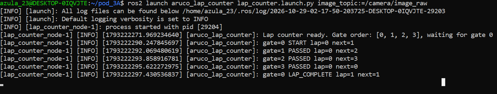
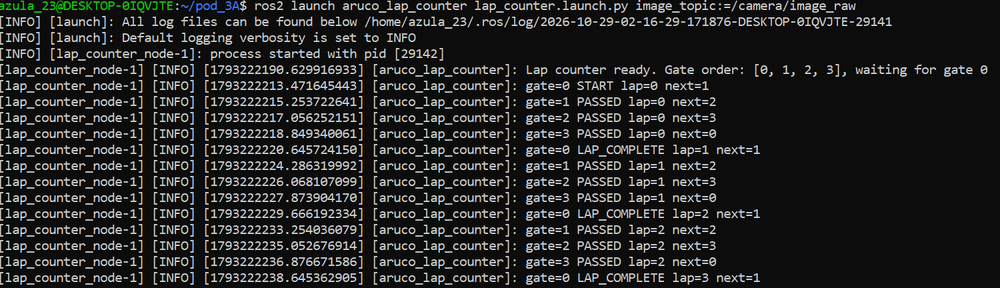
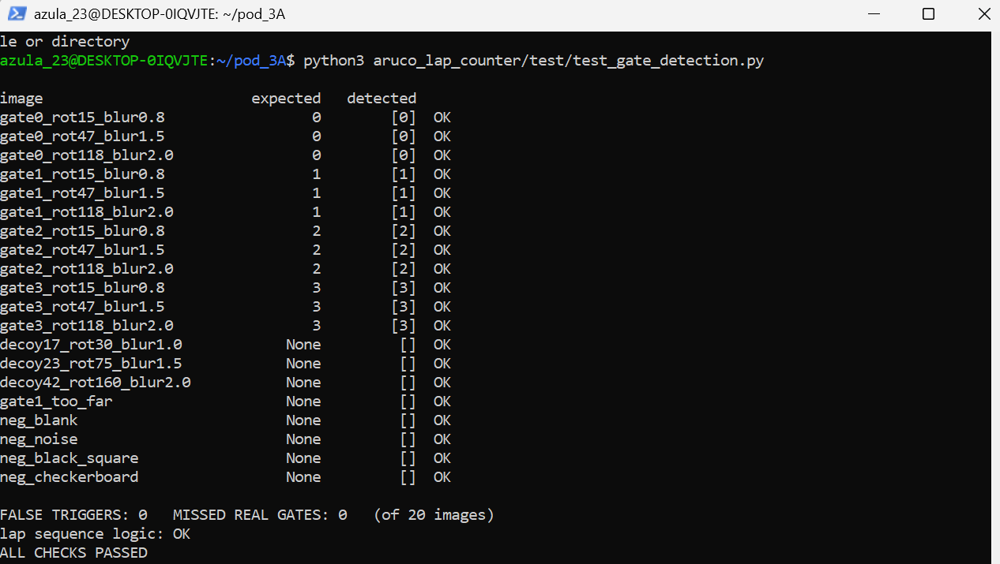

# aruco_lap_counter

**SEDS Pakistan, IST Chapter | Pod 3A | Task SEDS-TASK-ROV-SRILANKA-004**
ArUco Marker Lap Counter & Gate Detection Script (ROS 2 Python node)

Author: Mariam Raza

A ROS 2 (Humble) node that detects ArUco gate markers in a camera image stream and counts completed laps. Only OpenCV, numpy and standard ROS 2 packages are used (no non-standard dependencies).

## How it works

1. **`GateDetector`** finds ArUco tags with OpenCV and keeps only tags that
   - have an ID in the configured gate list (decoy tags and misreads are dropped),
   - are large enough in the frame (`min_side_px`) to count as "at the gate",
   - are not extremely skewed.
2. **`LapCounter`** is an ordered state machine. Gate 0 is start/finish. One lap is 0 -> 1 -> 2 -> 3 -> 0, in order. Out-of-order sightings are ignored.
   A gate must be seen in `confirm_frames` consecutive frames and cannot re-fire within `cooldown_s`, so single-frame flicker cannot trigger anything.
3. **`LapCounterNode`** is a thin ROS 2 wrapper around the two classes above.

Topics:

| Direction | Topic | Type |
|---|---|---|
| subscribes | `/camera/image_raw` | `sensor_msgs/Image` |
| publishes | `lap_count` | `std_msgs/Int32` |
| publishes | `gate_event` | `std_msgs/String` |
| publishes (optional) | `gate_debug_image` | `sensor_msgs/Image` |

## Repository layout

```
aruco_lap_counter/
├── aruco_lap_counter/
│   ├── lap_counter_node.py        # detection + lap logic + ROS 2 node
│   └── image_folder_publisher.py  # fake camera: publishes images from a folder
├── launch/lap_counter.launch.py
├── test/test_gate_detection.py    # 20-image check + lap logic tests (no ROS needed)
├── demo_images/                   # 5-image demo lap (gates 0,1,2,3,0)
├── docs/                          # screenshots of test runs
├── package.xml  setup.py  setup.cfg  resource/
```

## Build

```bash
mkdir -p ~/ros2_ws/src && cd ~/ros2_ws/src
git clone https://github.com/mariam-r23/seds-aruco-lap-counter.git aruco_lap_counter
cd ~/ros2_ws
source /opt/ros/humble/setup.bash
colcon build --packages-select aruco_lap_counter
source install/setup.bash
```

## 1. Verification check (no ROS needed)

Generates 20 rotated/blurred test images, feeds them to the detector and asserts **0 false gate triggers** and 0 missed gates, then tests the lap-order logic.

```bash
pip install opencv-contrib-python numpy
python3 test/test_gate_detection.py
```

The 20 images: 12 real gate tags (IDs 0-3, rotated and blurred), 3 decoy tags with IDs that are not gates, 1 gate tag too far away, and 4 non-tag images (blank, noise, black square, checkerboard). The images are saved to `test/images/`.

## 2. Run in ROS 2 with no camera

Terminal 1, the lap counter:
```bash
ros2 launch aruco_lap_counter lap_counter.launch.py image_topic:=/camera/image_raw
```

Terminal 2, the fake camera (plays the images in filename order):
```bash
# one pass = exactly 1 lap
ros2 run aruco_lap_counter image_folder_publisher --ros-args -p folder:=$HOME/ros2_ws/src/aruco_lap_counter/demo_images

# repeat forever to see laps accumulate
ros2 run aruco_lap_counter image_folder_publisher --ros-args -p folder:=$HOME/ros2_ws/src/aruco_lap_counter/demo_images -p loop:=true
```

Terminal 3, optional:
```bash
ros2 topic echo /lap_count
ros2 topic echo /gate_event
```

With a real camera, skip Terminal 2 and set `image_topic` to the camera's topic.

## Test results (ROS 2 Humble)

Single pass (`loop:=false`) gives exactly one lap:



Looped (`loop:=true`) counts laps 1, 2, 3 with every gate in order and no extra triggers:



Offline self-check (20 images, 0 false triggers):



## Parameters

| name | default | meaning |
|---|---|---|
| `image_topic` | `/camera/image_raw` | camera input topic |
| `gate_sequence` | `[0,1,2,3]` | gate IDs in lap order, first = start/finish |
| `aruco_dictionary` | `DICT_4X4_50` | must match the printed tags |
| `min_side_px` | `40.0` | minimum tag size to count as a gate pass |
| `confirm_frames` | `3` | consecutive frames needed to confirm a gate |
| `cooldown_s` | `2.0` | minimum seconds between triggers of the same gate |
| `publish_debug_image` | `false` | publish an annotated image on `gate_debug_image` |

## Notes

- Compatible with OpenCV >= 4.7 and the OpenCV 4.5.x shipped with ROS 2 Humble.
- If your tags use a different dictionary or IDs, change `aruco_dictionary` and `gate_sequence`.
- Test images are synthetic (generated with OpenCV), not photographs from a real rover camera.
